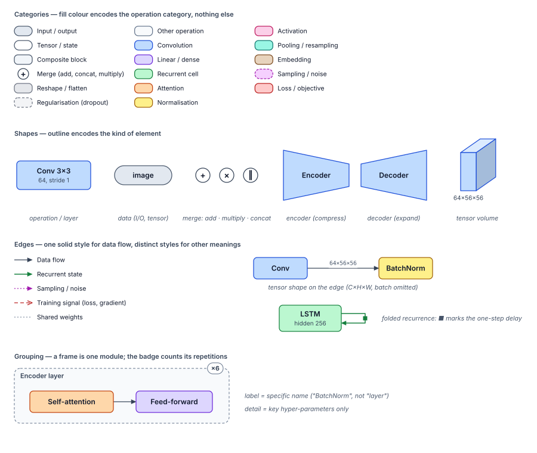

# Tensorgami

Draw the architecture and information flow of deep-learning / machine-learning models,
locally, in Python.

Status: design phase (see [roadmap.md](roadmap.md)).

- Literature survey: [docs/survey/tensorgami-literature-survey.pdf](docs/survey/tensorgami-literature-survey.pdf)
- Drawing styles: [`default`](docs/style/style-baseline.md) and [`origami`](docs/style/origami.md)



## Development

```sh
uv sync                                        # create the environment
uv run pytest                                  # run the tests
uv run ruff check . && uv run ruff format .    # lint / format
uv run python docs/style/build_specimens.py    # rebuild the style specimens
uv run python docs/survey/build.py             # rebuild the survey PDF
```

## Capturing a PyTorch model

The pipeline already works end to end, from a PyTorch model to a PNG or a notebook figure:

```python
import torch
from tensorgami.importers.torch import trace

graph = trace(model, torch.randn(1, 3, 32, 32))   # runs the model once, leaves it untouched
print(graph.summary())                              # every operation, its module and shape

from tensorgami.transforms import simplify
print(simplify(graph, level=2).summary())           # layers: activations folded, repeats ×N

import tensorgami as tg
from tensorgami.layout import layout
from tensorgami.style import load_style
style = load_style("default")                       # or load_style("origami")
layers = simplify(graph, level=2)
fig = tg.Figure(layout(layers, style), style, layers)
fig                                                 # shows inline in Jupyter
fig.save("model.png", dpi=300)                      # or .svg / .pdf
```

Step 10 shortens this to `tg.draw(model, example_input, style="default")`. See
[`examples/alexnet.ipynb`](examples/alexnet.ipynb) for a notebook.

See the automatically drawn [gallery](docs/gallery/README.md).

## Drawing a scene today

Automatic layout is a later roadmap step; today a hand-positioned scene can be rendered in
the baseline style:

```python
from tensorgami.render import add_legend, render_svg
from tensorgami.scene import Box, Edge, Node, Point, Scene
from tensorgami.style import load_theme
from tensorgami.vocabulary import OpCategory

theme = load_theme()  # the baseline theme, validated
scene = Scene(420, 140)
scene.add(
    Node("x", Box.centered(50, 40, 70, 32), OpCategory.IO, "image"),
    Node("c", Box.centered(190, 40, 120, 46), OpCategory.CONV, "Conv 3×3", "64, ReLU"),
    Node("y", Box.centered(350, 40, 90, 32), OpCategory.IO, "features"),
    Edge("x", "c"),
    Edge("c", "y", label="64×32×32"),
)
add_legend(scene, theme, Point(16, 84), columns=3)
open("conv.svg", "w").write(render_svg(scene, theme))
```
