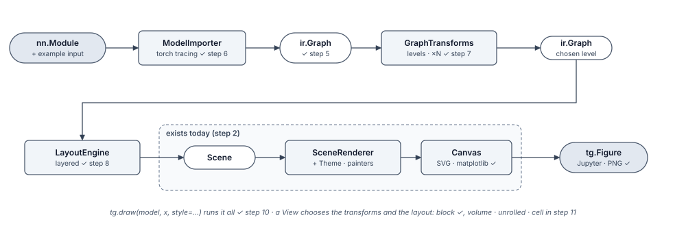

# Tensorgami architecture

How a PyTorch model becomes a figure. The decisions behind this page are recorded in
[docs/adr](adr/README.md); the requirements are in [requirements.md](requirements.md).

*Drawn with Tensorgami itself (`uv run python docs/build_architecture.py`).*

## Stages

| Stage | Contract | Input → output | Status |
|---|---|---|---|
| Importer | `ModelImporter` protocol | `nn.Module` + example input → `ir.Graph` | ✅ step 6 ([ADR-0003](adr/0003-pytorch-capture.md)) |
| IR | immutable dataclasses + `GraphBuilder`, rules, JSON | nodes, edges, module invocations, repeats, shapes | ✅ step 5 ([ADR-0002](adr/0002-intermediate-representation.md)) |
| Transforms | `GraphTransform` protocol (`Graph → Graph`), `Pipeline` | full trace → chosen level of detail (`simplify(graph, level)`) | ✅ step 7 |
| Layout | `LayoutEngine` protocol (`Graph → Scene`) | graph → positioned nodes and routed edges | step 8 ([ADR-0004](adr/0004-layout-engine.md)) |
| Scene | `Scene`, `Node`, `Edge`, `Group`, `Note` | positioned diagram | ✅ step 2 |
| Rendering | `SceneRenderer`, `GlyphPainter`, `Canvas` protocols | scene + theme → drawing | ✅ SVG (step 2) · matplotlib step 9 ([ADR-0005](adr/0005-figure-backend.md)) |
| Style | `Theme` (TOML) + validation rules | all visual decisions | ✅ step 2 |
| View | `View` strategy | picks transforms, layout and glyph mapping | step 11 |
| API | `tg.draw(...)` → `tg.Figure` | wires the stages; display and save | step 10 ([ADR-0007](adr/0007-public-api.md)) |

## Rules every stage follows

- **Dependencies point one way** (ADR-0001). For example, `ir` knows nothing about drawing
  and `render` knows nothing about torch. Allowed imports per package are listed in
  [`tests/test_architecture.py`](../tests/test_architecture.py), and the build fails on a
  violation.
- **torch only in `importers`, matplotlib only in `render`** (ADR-0006), so the core imports
  without either.
- **New behaviour is added by registration, not by editing:** themes are TOML files, shapes
  are painters in a `PainterRegistry`, leaf modules are a registry in the importer, views are
  strategies.
- **Drawing is non-invasive and deterministic:** the model, its mode and the caller's RNG are
  untouched (NFR3), and the same input gives a byte-identical figure on every supported
  Python version (NFR4; floats are summed with `math.fsum` for this reason).

## Supported versions

Python ≥ 3.11 (tested on 3.11 and 3.12) · torch ≥ 2.2 (2.2.2 locally, the last Intel-Mac
release) · matplotlib as the only runtime dependency (from step 9).
