# Gallery (preview)

Every figure on this page is drawn **automatically** from a PyTorch model: the model is traced
(step 6), simplified to the layer level (step 7) and laid out (step 8). Nothing is positioned
by hand. The models are the small reference implementations in
[`tests/models/`](../../tests/models/). Rebuild with
`uv run python docs/gallery/build_gallery.py`.

## CNN with residual blocks: layer level

The two identical residual blocks fold into one frame marked ×2. The skip connection enters
through a port and runs above the block's main path. Activations are folded into the layer
before them, and shapes appear only where they change.

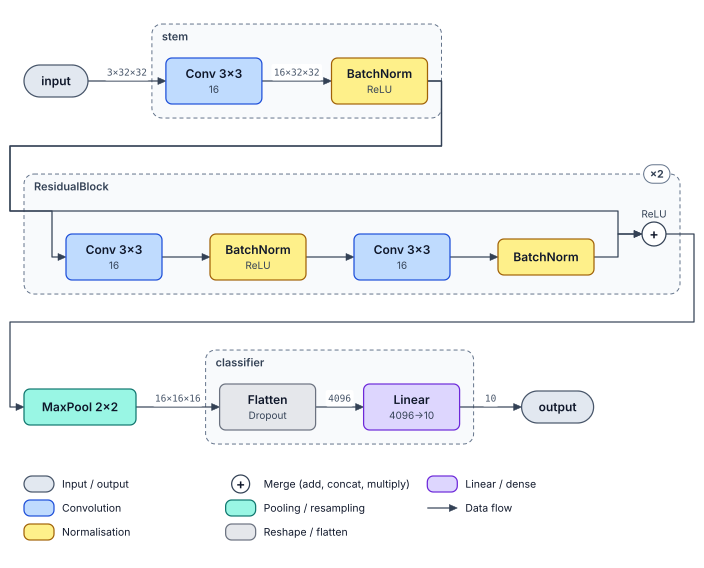

## The same CNN: stage level (L1)

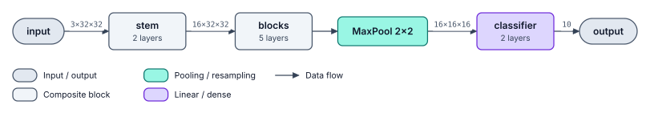

## LSTM classifier

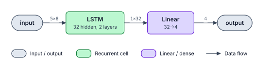

## Conditional GAN: generator and discriminator

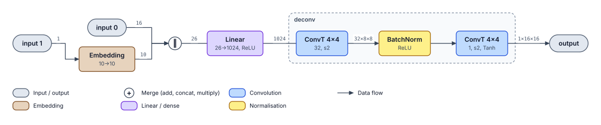

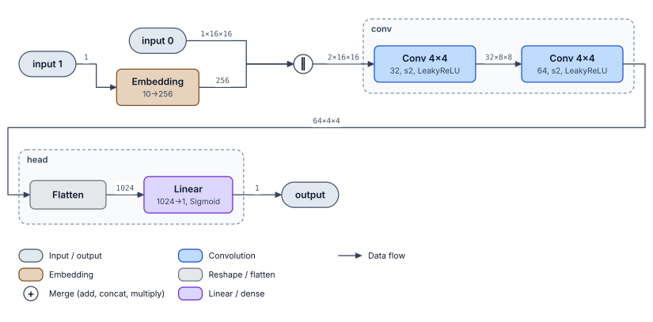

## VAE

The noise ε is a dashed source with a dotted arrow, kept separate from μ (the
reparameterisation trick).

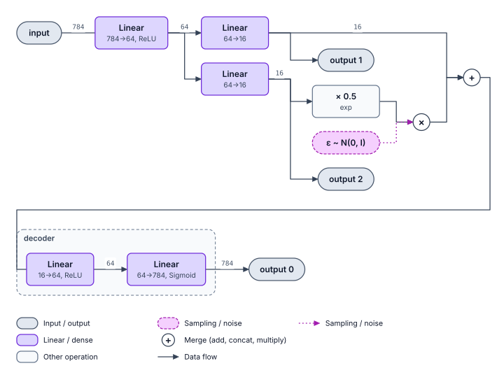

## ConvLSTM encoder

Each ConvLSTM layer is one cell, drawn once with its recurrent h/c state loops (■ = one-step
delay) and marked ×3 for the three time steps.

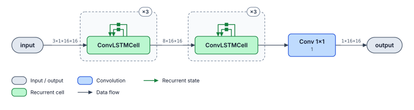

## Transformer encoder: top to bottom

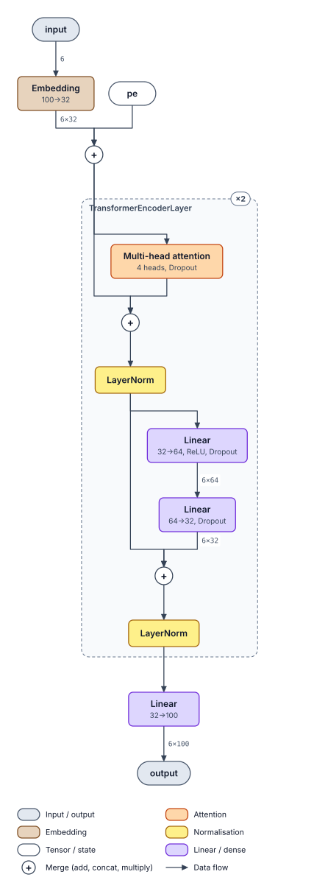

## AlexNet

From [`examples/alexnet.py`](../../examples/alexnet.py): torchvision's AlexNet traced on one
224×224 image, at the layer level, top to bottom, and at the stage level. The collapsed
blocks are named after their attributes and coloured by their contents.

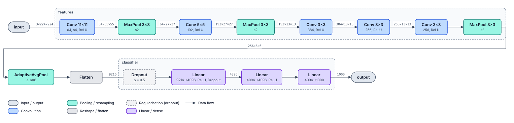

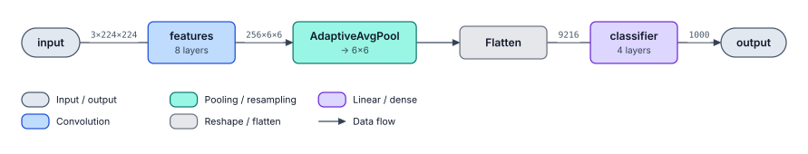

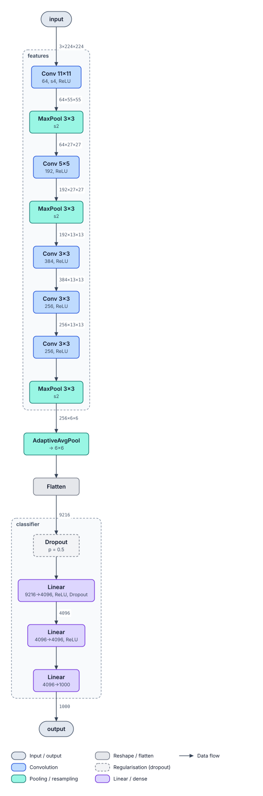

## Origami style

The same models drawn with `style="origami"`: upright cards, left → right (see [the style
page](../style/origami.md)).

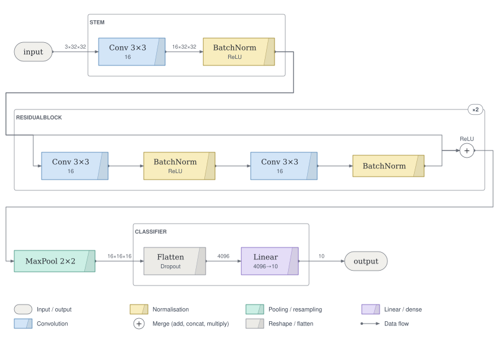

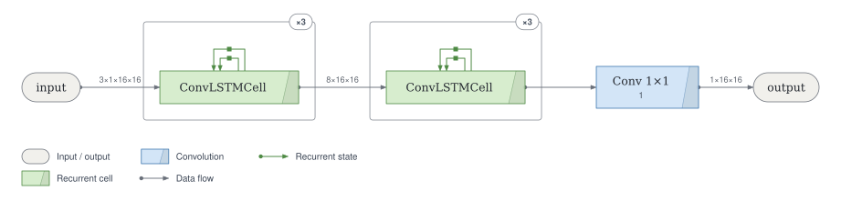

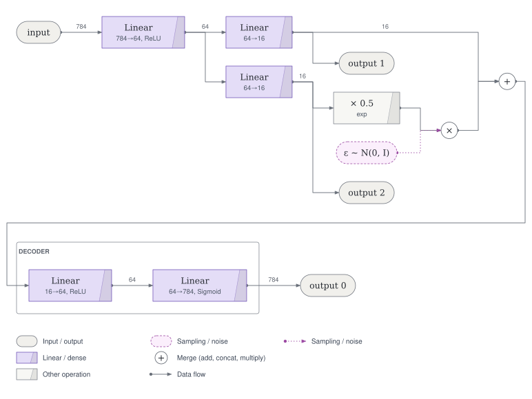

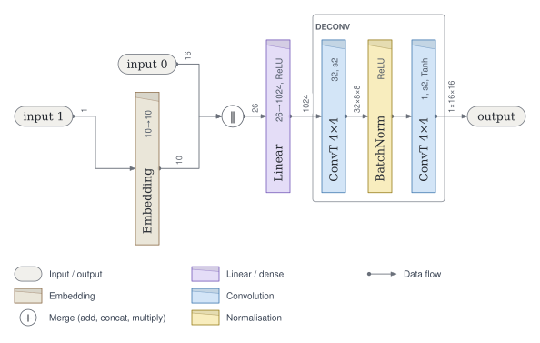

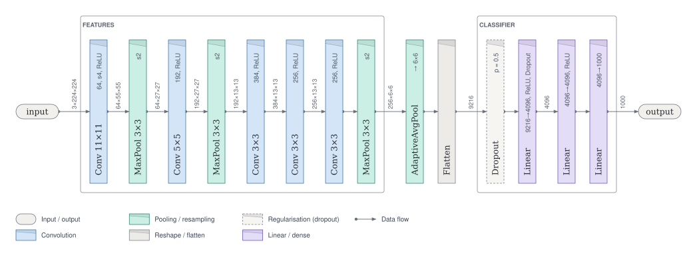

## Origami-extended style

With `style="origami-extended"`: flat single-line cards, top → bottom.

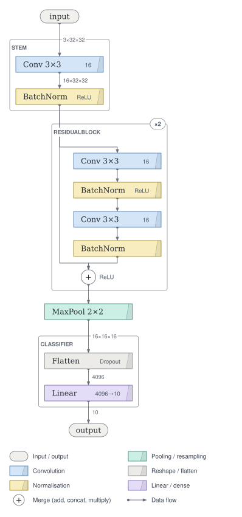
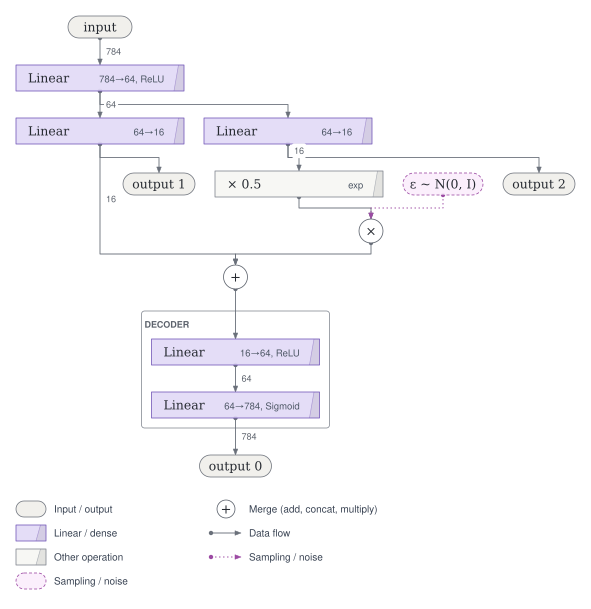

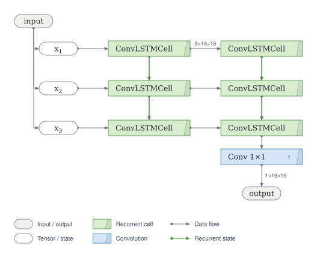
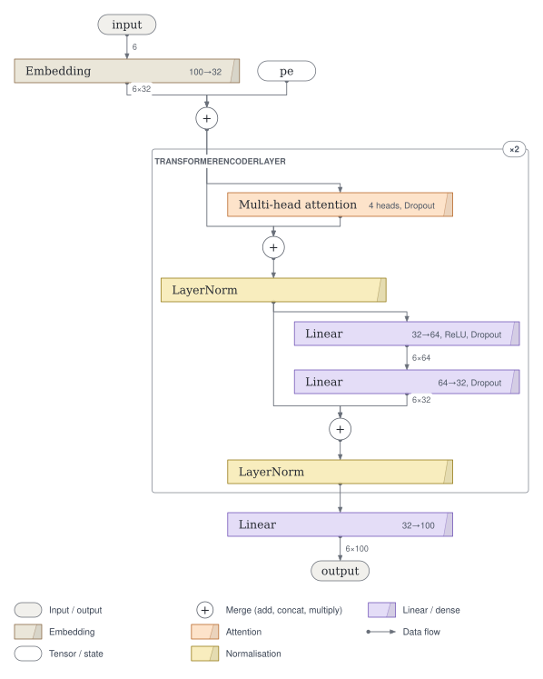
