# Acceptance gallery

Every figure on this page is drawn **automatically** from a PyTorch model with `tg.draw`: the
model is traced, simplified to the chosen level and laid out; nothing is positioned by hand.
The models are the small reference implementations in [`tests/models/`](../../tests/models/),
one per family (CNN, LSTM, ConvLSTM, cGAN, VAE, Transformer, pix2pix), and AlexNet from
[`examples/alexnet.py`](../../examples/alexnet.py). Every figure exists in each built-in
style: `default` on this page, [`origami/`](origami/) and [`origami-extended/`](origami-extended/)
below.

**Accepted by tests (roadmap step 12).** [`tests/test_gallery.py`](../../tests/test_gallery.py)
redraws every figure in every style and checks that it

- keeps the layout invariants: no overlapping boxes, no wire through a box, only horizontal
  and vertical wire segments, every box inside its frames;
- matches the committed SVG byte for byte, so any change to a drawing fails the test until
  it has been reviewed here and accepted by rebuilding the gallery:
  `uv run python docs/gallery/build_gallery.py`.

## CNN with residual blocks: layer level

The two identical residual blocks fold into one frame marked ×2. The skip connection enters
through a port and runs above the block's main path. Activations are folded into the layer
before them, and shapes appear only where they change.

## The same CNN: stage level (L1)

## LSTM classifier

The fused `nn.LSTM` (2 layers) is one box; `view="unrolled"` draws it as a grid: a column
per time step, a row per layer, the per-step inputs x_t below and state passed along each row.
The 5-step sequence shows steps 1–3, "⋯" and step 5.

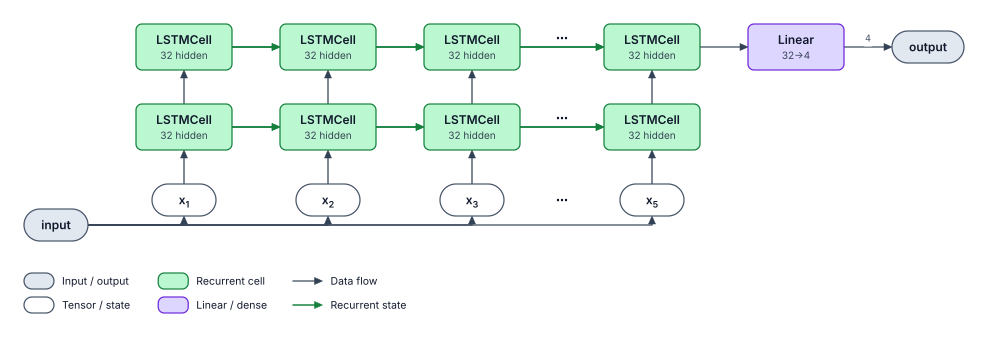

## Conditional GAN: generator and discriminator

Both in one figure (`tg.draw({"generator": G, "discriminator": D}, …)`): the generator's output
linked to the image input of the discriminator, one condition feeding both, the real images as
an extra input, and the adversarial loss with dashed training arrows back to both models. At
`level=0` each model is one box:

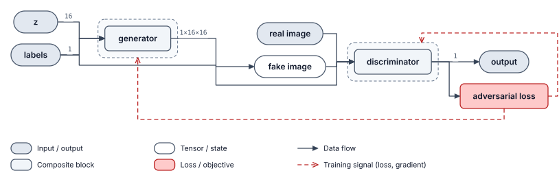

Layer by layer, top to bottom:

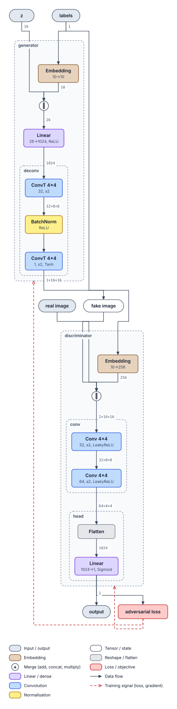

## VAE

The noise ε is a dashed source with a dotted arrow, kept separate from μ (the
reparameterisation trick).

With its loss terms (`annotations=[tg.Loss("reconstruction", "output 0", "input"),
tg.Loss("KL divergence", "mu", "logvar")]`) and μ, log σ² named through `overrides`:

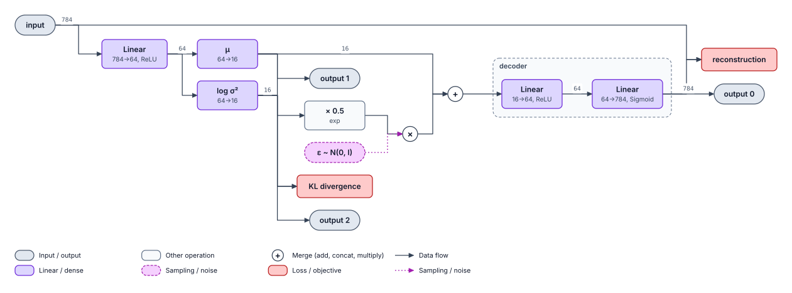

## ConvLSTM encoder

The cells are called in a Python loop over time, so `view="auto"` unrolls them: the frames
x₁…x₃ enter the first layer, h and c pass from step to step (green), and the last state of the
top layer feeds the 1×1 convolution.

With `view="block"` each layer is one cell, drawn once with its recurrent h/c state loops
(■ = one-step delay) and marked ×3 for the three time steps.

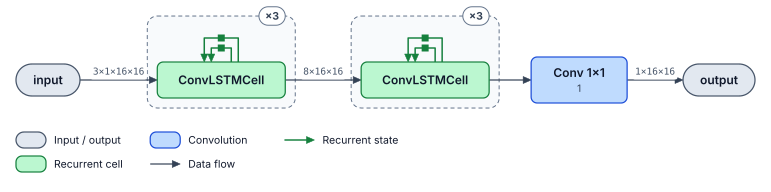

With `view="cell"`, the cell itself, as its gates: the LSTM is recognised from the traced
operations, and its gates are coloured as the convolution that computes them.

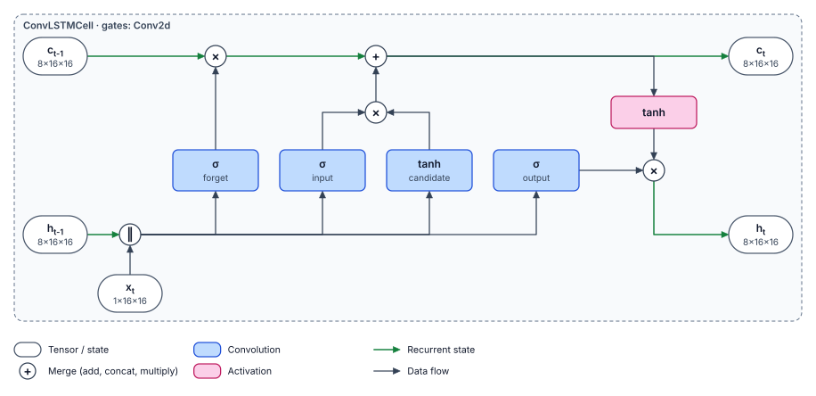

The fused `nn.LSTM` of the LSTM classifier, the same way:

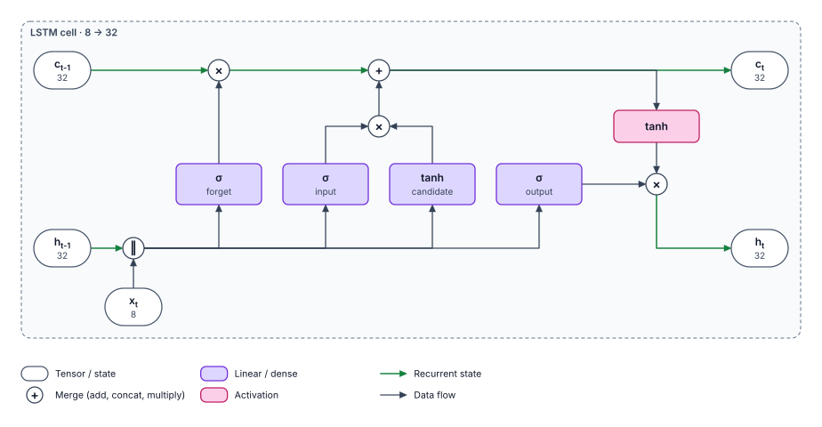

## pix2pix: U-Net generator and PatchGAN discriminator

The generator's skip connections nest inside each other, so it is drawn as a U: one row per
level, encoder on the left, decoder on the right, each skip a short arrow into its concat (‖),
the bottleneck below. Each level's in-place LeakyReLU is folded into the layer before it, and
the decoder's ReLU into the concat. (Small sizes here: 5 levels, 32×32 images.)

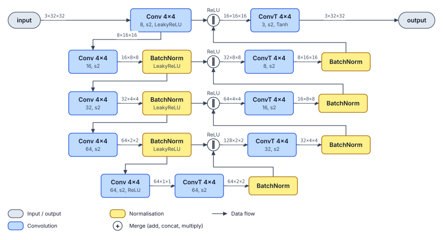

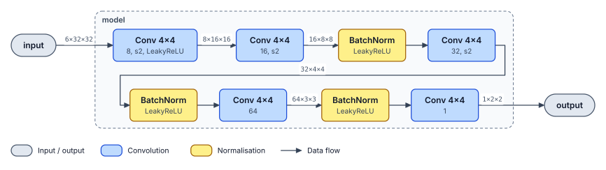

The whole system in the volume view: the generator's volumes descend and climb as in the
U-Net paper; its output, fake B, and the real B each enter the discriminator together with
the input A (`ConditionalDiscriminator` stacks them, as pix2pix's training code does); the
GAN loss trains both networks, the L1 loss between fake and real B the generator:

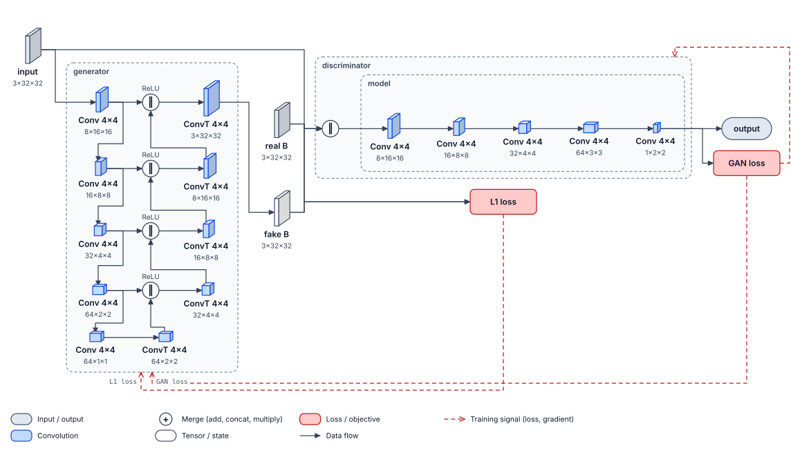

## Transformer encoder: top to bottom

## AlexNet

From [`examples/alexnet.py`](../../examples/alexnet.py): torchvision's AlexNet traced on one
224×224 image, at the layer level, top to bottom, and at the stage level. The collapsed
blocks are named after their attributes and coloured by their contents.

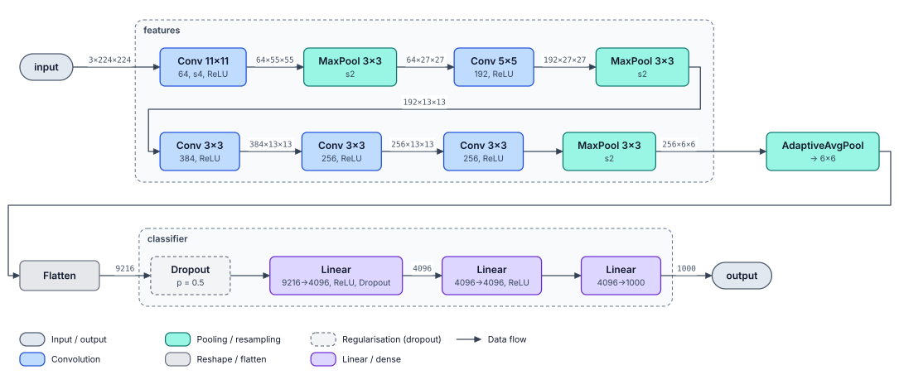

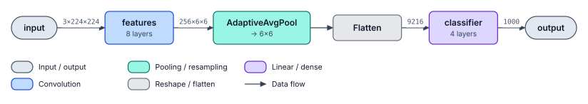

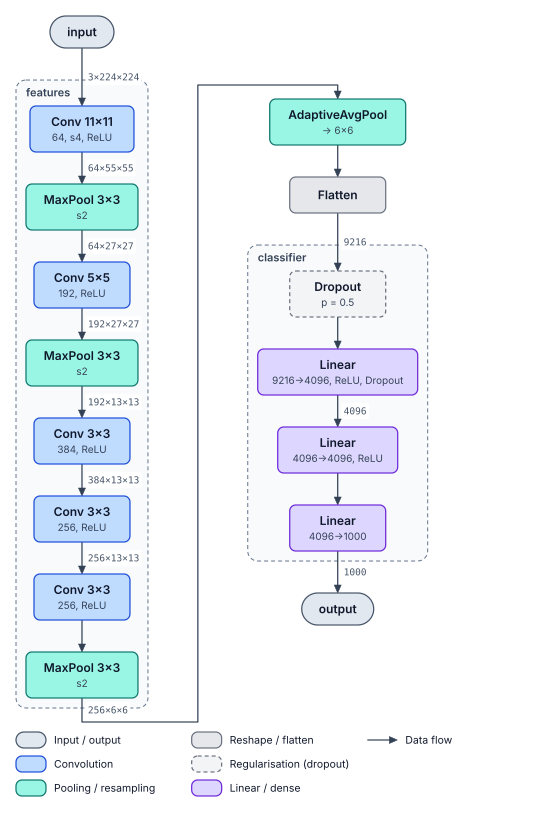

With `view="volume"`, every layer is drawn as the tensor it produces, C × H × W, as in the
original paper; the dense layers are bars.

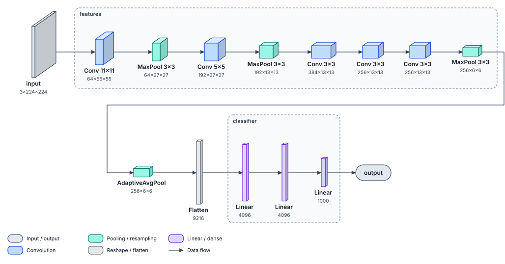

## ResNet-18: rows inside frames

From [`examples/resnet.py`](../../examples/resnet.py): torchvision's ResNet-18 at the layer
level. A figure wider than `wrap_width` (1100 px by default) wraps into rows that read like
lines of text, and so does a frame wider than the room it has: each stage holds its two
residual blocks one above the other. A row only ends where a single wire continues, so a
residual block, with its skip alongside, is never split. (Above, AlexNet's `features` wraps
the same way.)

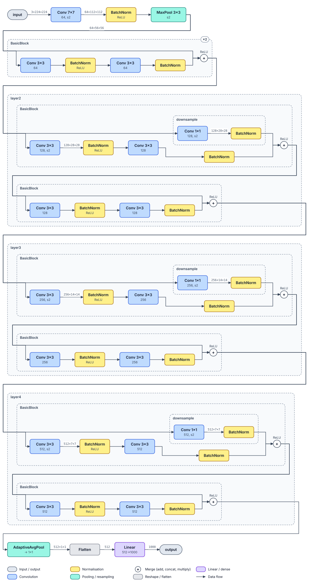

## Variants: dark and greyscale

`variant="dark"` recolours any style for slides with a dark background: the cards keep their
fills and dark text, while wires, outlines, frames and the text on the background are
lightened just enough to stand out. `variant="greyscale"` is for black-and-white print: every
colour becomes the grey of the same luminance, so every contrast is kept, and the category
fills are spread over a wider range of greys so they stay apart. Both pass the same checks as
every style.

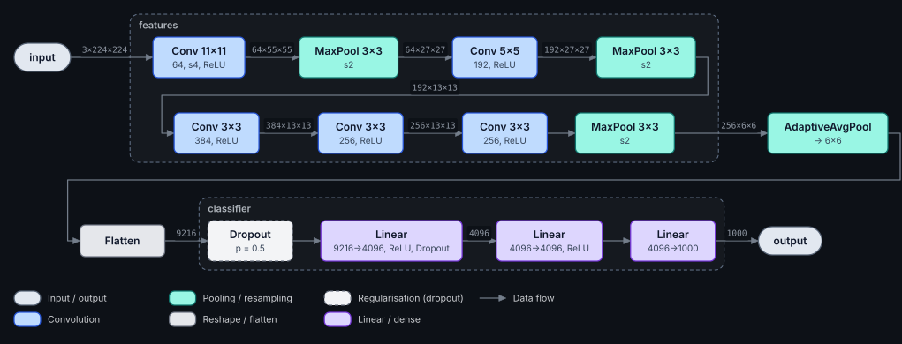

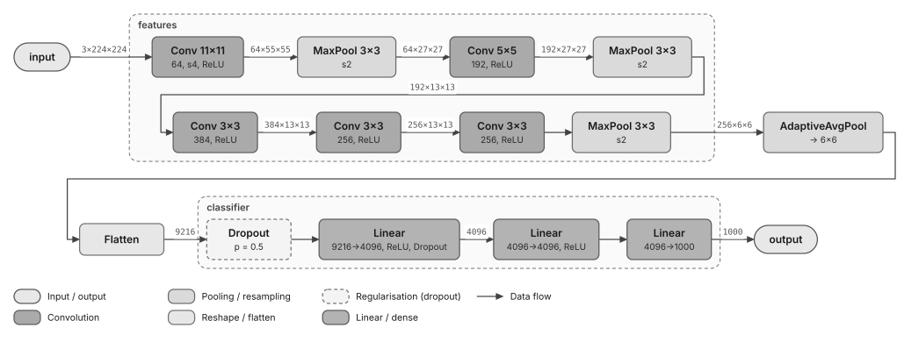

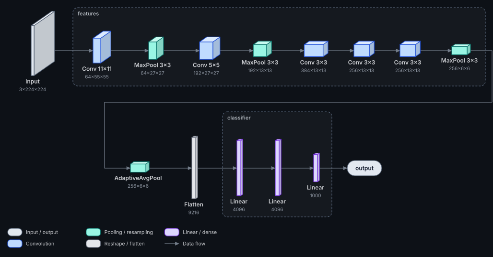

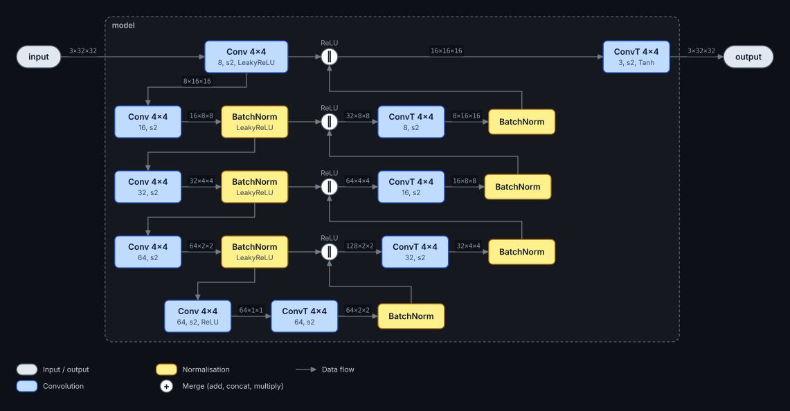

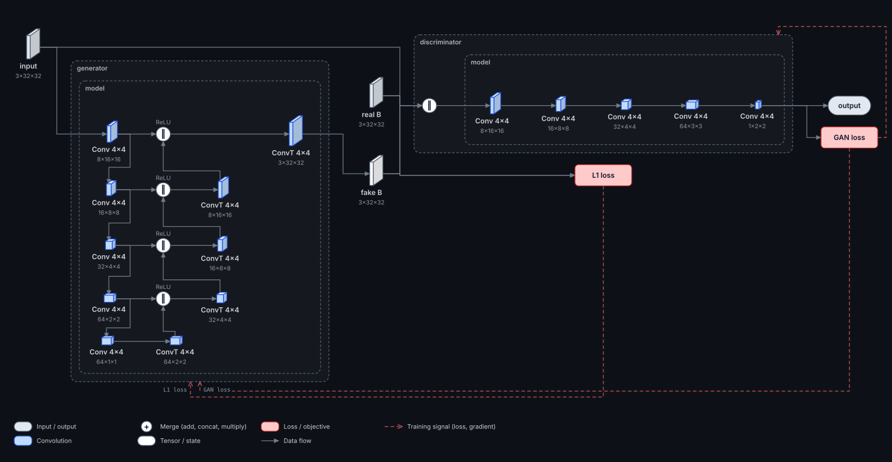

The origami styles too:

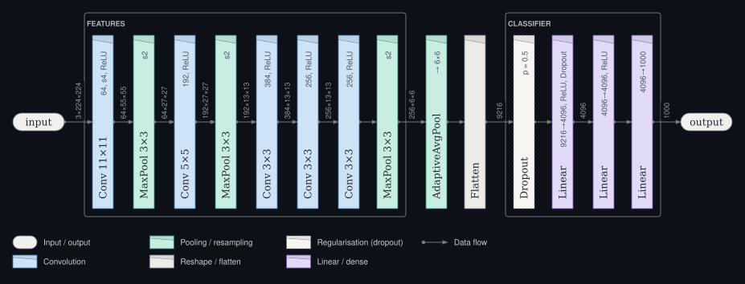

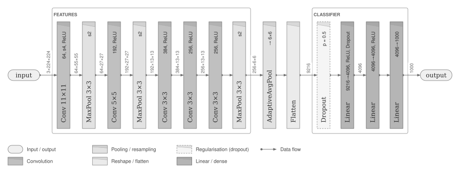

## Origami style

The same models drawn with `style="origami"`: upright cards, left → right (see [the style
page](../style/origami.md)).

## Origami-extended style

With `style="origami-extended"`: flat single-line cards, top → bottom.

Left to right instead (`direction="LR"`): name above details, each card as wide as its text.

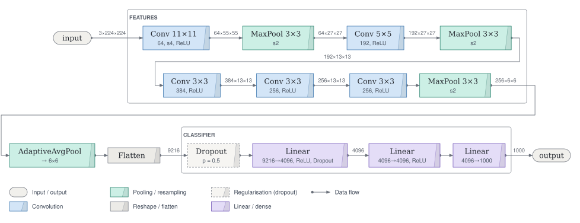
