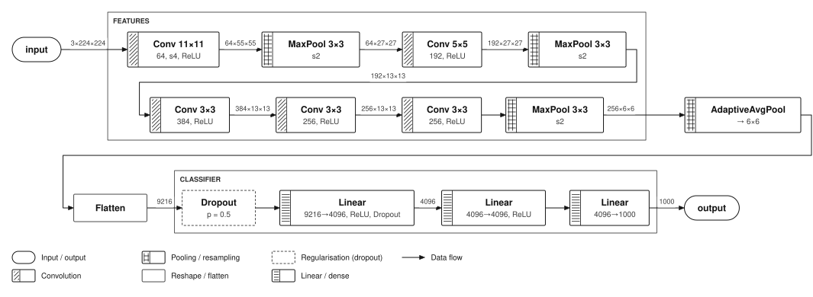
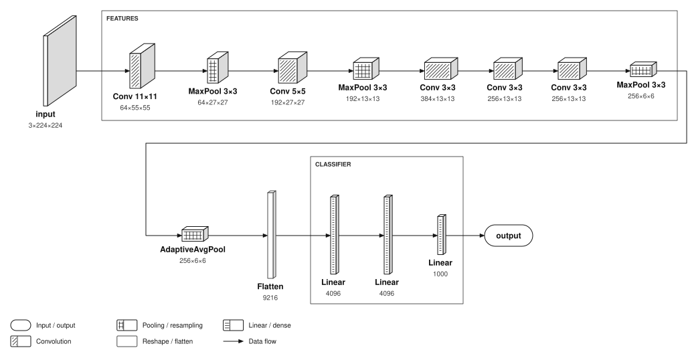
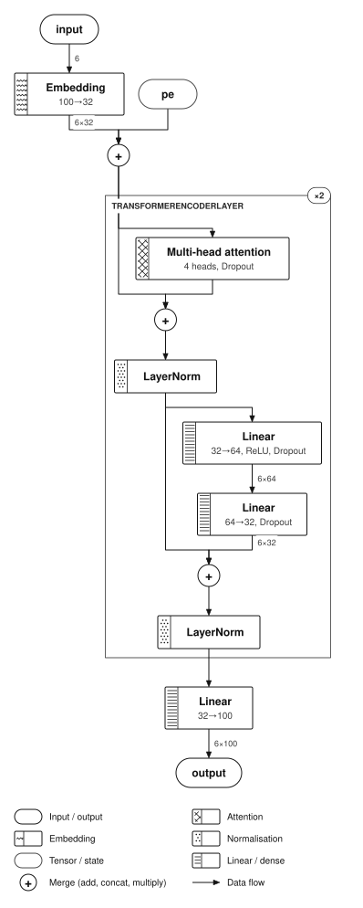
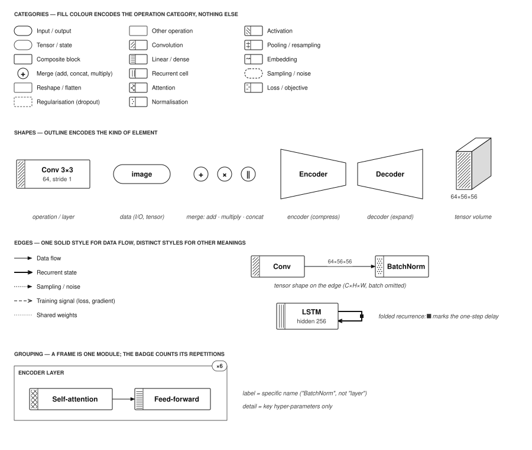

# Tensorgami drawing style — `etching`

**Status:** built-in style (2026-10-16, step 13d, ADR-0008) · **Style file:**
[`etching.toml`](../../src/tensorgami/style/themes/etching.toml)

Black ink on white paper, like an engraved plate. The operations are told apart by **engraved
textures instead of colour**: each layer's box carries a narrow textured strip at its start
(diagonal lines for convolutions, dots for normalisation, a cross-hatch for attention…), while
its name and details stay on plain white. A tensor volume's face is engraved whole. The wires
are one ink, told apart by line style only.

```python
import tensorgami as tg

tg.draw(model, example_input, style="etching")
tg.draw(model, example_input, style="etching", view="volume")       # engraved volumes
tg.draw(model, example_input, style="etching", palette="tab10")     # coloured textures
```



## Why this style

The third style was chosen after a short survey of what the other two leave out (2026-10-16):

- **Black-and-white print.** Journals that print in black and white ask for patterns, not for
  greys of similar lightness, and for colour never to be the only cue: Elsevier's artwork
  instructions say a figure printed in greyscale must not depend on similar shades and should
  use patterns or dashed lines instead; the AAS graphics guide suggests line styles, symbols
  and hatching. The `greyscale` variant can only vary lightness, which cannot separate ten
  categories; textures can.
- **Colour-vision deficiency.** A texture reads the same for every reader and survives
  photocopies and projectors.
- **Evidence for textures.** He, Zhong, Isenberg and Isenberg (*Design Characterization for
  Black-and-White Textures in Visualization*, IEEE TVCG 30(1), 2024) found textured charts
  read about as well as untextured ones. The experts they studied kept textures 45° apart in
  orientation and the ink density even across categories, and set textures off from outlines
  with a white halo. The style follows all three.
- **Journal conventions.** Helvetica or Arial; lines of 0.75 pt (Nature asks for 0.25–1 pt at
  final size); text from 6.75 pt (shapes) to 9 pt (names) at true size, within Nature's 5–7 pt
  minimum and AAS's 6 pt.
- **Guidance for neural-network diagrams.** Marshall, Freitas and Jay (*An evidence-based
  guidance framework for neural network system diagrams*, PLOS ONE, 2025) ask for colour only
  where it groups, and for consistency; the etching style needs no colour at all.

## The textures

| Category | Texture | | Category | Texture |
|---|---|---|---|---|
| Convolution | diagonal `////` | | Pooling / resampling | grid `+++` |
| Activation | back-diagonal `\\\\` | | Normalisation | dots `···` |
| Linear / dense | horizontal `≡` | | Embedding | zigzag `/\/\` |
| Recurrent cell | vertical `\|\|\|` | | Loss / objective | short dashes (brickwork) |
| Attention | cross-hatch `×××` | | Sampling / noise | dashed pill (no texture) |

Inputs, outputs, tensors, merges and reshapes stay plain; dropout keeps its dashed outline.
Every texture is drawn as plain lines, dots and rectangles clipped to its strip, so the SVG
and the matplotlib output (PNG, PDF) are identical and deterministic. The lines are anchored
to the page, so the textures of neighbouring boxes line up. The style checks gained a rule:
no two categories may share a texture.

| Element | `etching` |
|---|---|
| Layers | white boxes with square corners and a hairline (0.75 pt) outline; a textured strip at the start, behind a white gap and a hairline |
| Volumes | the front face engraved with the layer's texture |
| Wires | one ink: data solid with a filled arrowhead; recurrent state bold with an open one (Olah's "conveyor belt"); sampling dotted; training dashed with an open arrowhead |
| Frames | solid hairline, no fill, square corners, small capital titles |
| Text | Helvetica / Arial; names semibold, details and shapes in a dark grey |





The vocabulary in one sheet:



## With palettes and variants

A palette colours the textures and outlines (`palette="tab10"`: a blue diagonal strip for a
convolution) while the boxes stay white; `variant="dark"` engraves in light ink on a dark
board. Every combination passes the same checks as every style.

More in the [gallery](../gallery/README.md#etching-style) and in
[`specimens/etching/`](specimens/etching/).
