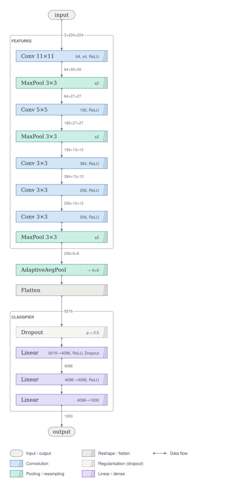
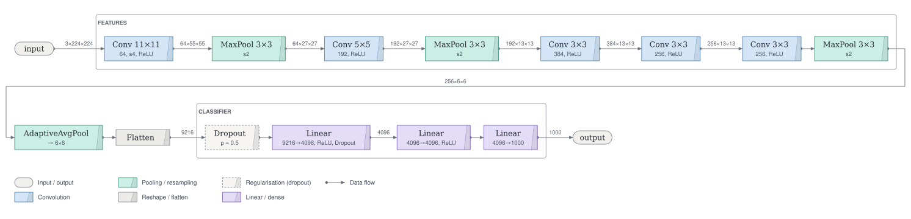
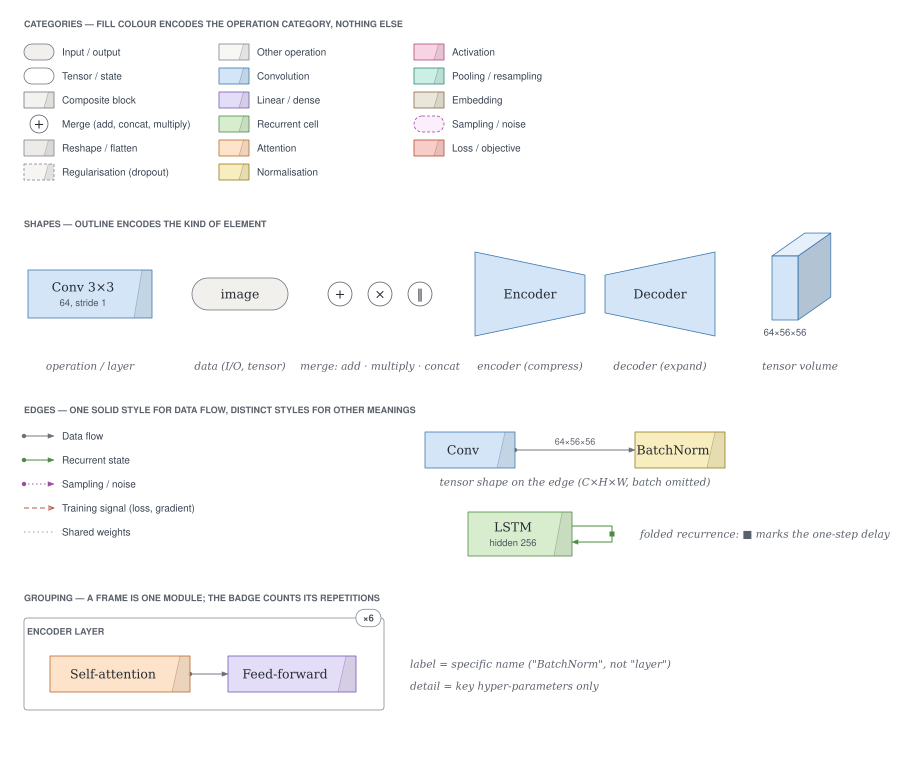

# Tensorgami drawing styles — `origami` and `origami-extended`

**Status:** built-in styles (2026-10-11, ADR-0008) · **Style files:**
[`origami.toml`](../../src/tensorgami/style/themes/origami.toml),
[`origami-extended.toml`](../../src/tensorgami/style/themes/origami-extended.toml)

A lighter, more illustrative alternative to the [`default`](style-baseline.md) style, after
the radial figure in DeepMind's essay *Bending the curve of discovery*: thin "wires", paper,
pastels and white space. Both styles keep every rule of the default style (colour = operation
category, one line style for data flow, shapes where they change, ×N for repeats) and pass
the same validation (text contrast ≥ 4.5:1, outlines ≥ 3:1, distinct category colours).

```python
import tensorgami as tg

tg.draw(model, example_input, style="origami")  # upright cards, left → right
tg.draw(model, example_input, style="origami-extended")  # flat cards, top → bottom
```

## The two styles

They share the look and differ in how a layer's card holds its text, which decides how much
room a figure needs:

| | `origami` | `origami-extended` |
|---|---|---|
| Default direction | left → right | top → bottom |
| Left → right | **upright cards**: one line of text reading bottom → top (name at the bottom, details at the top), the fold on top, all cards equally tall; the tensor shapes between them stand upright too | name above details, each card as wide as its own text |
| Top → bottom | flat single-line cards of equal width: name on the left, details on the right, like a table | the same |

AlexNet, `origami` (1047 × 390 px; a layer takes about 60 px of width):


AlexNet, `origami-extended` (535 × 1151 px; `origami` top → bottom looks the same):



`origami-extended` left → right (1492 × 360 px):



Use `origami` for horizontal figures that must fit a slide or a page width, especially deep
sequential networks; `origami-extended` for figures in a notebook or a column (they scroll
down instead of shrinking) and when level text matters more than width.

## The shared look

| Element | `default` | origami styles |
|---|---|---|
| Layers | rounded boxes, solid tint | **folded paper cards**: a slanted crease and a slightly darker folded strip; sharp corners; translucent pastel |
| Lines | 1.25 px, filled arrowheads | **hairline wires** (0.9 px, soft slate) starting with a small **dot terminal**, fine arrowheads |
| Frames | dashed, light fill | **solid hairline, no fill**, small capital titles |
| Labels | sans-serif, semibold | **serif** (Source Serif / Georgia), regular; details in grey sans |
| Palette | saturated tints | pastels: sky, lavender, sage, peach, butter, blush, mint, sand, coral |

The palette and shapes in one sheet (placed by hand, so the cards keep stacked text):



More in the [gallery](../gallery/README.md#origami-style) and in
[`specimens/origami/`](specimens/origami/) and
[`specimens/origami-extended/`](specimens/origami-extended/).

## How it is built

Each style is one TOML file. The renderer gained capabilities that any style can use by name:
the `folded` shape, translucent fills (`opacity`), dot terminals (`start = "dot"` /
`arrow = "dot"`), frames without a fill (`fill_opacity = 0`), `caps` fonts, and the `[boxes]`
table for box sizes and text arrangement:

```toml
[boxes]
text = { TB = "inline", LR = "rotated" }  # per flow direction: "stacked", "inline", "rotated"
height = 26                               # a card with one line (its thickness, upright)
uniform_width = true                      # single-line cards share one length
```

The layout sizes each box for its arrangement and records it on the box, so the painter draws
exactly what was sized; upright text is rotated in both outputs (SVG and matplotlib). The
`default` style uses none of this and looks as before.
