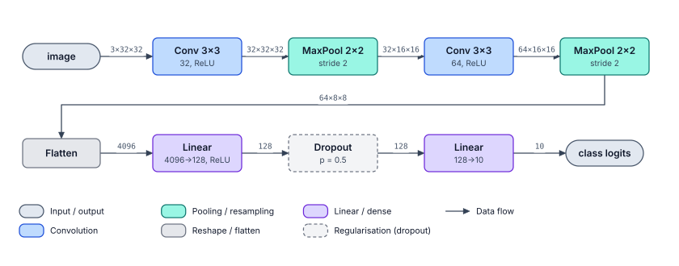
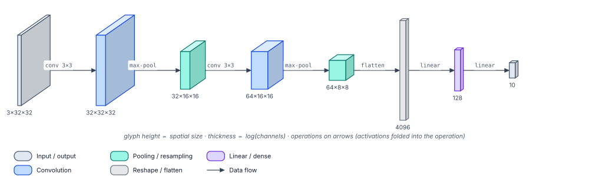
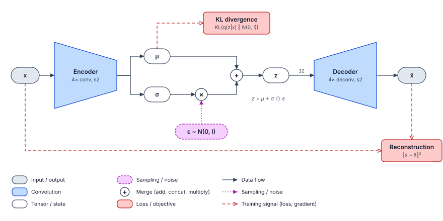
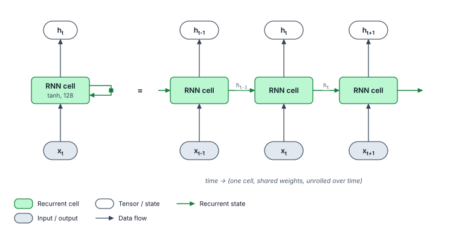
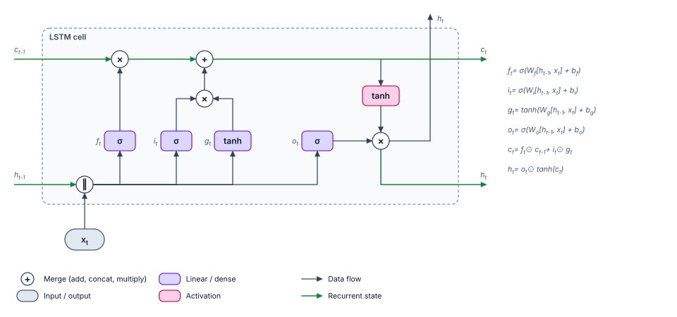
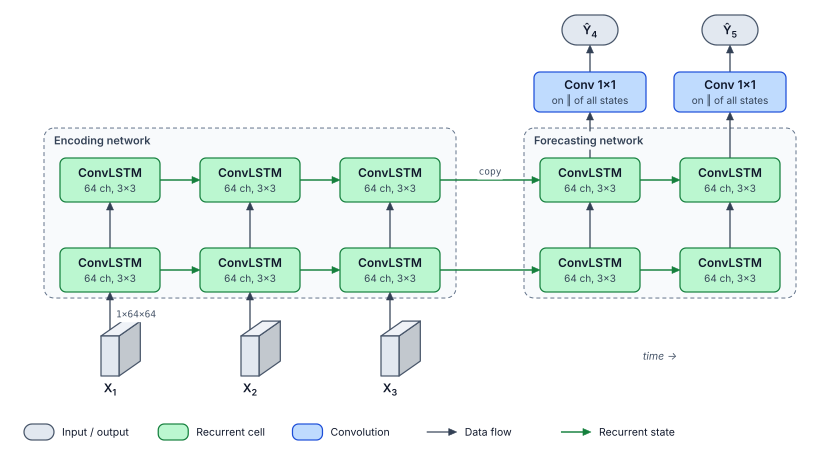
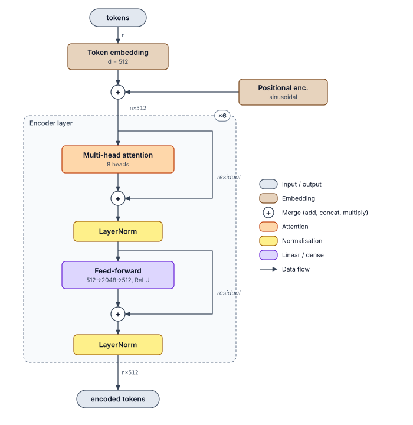

# Tensorgami drawing style — baseline

**Status:** draft for review (roadmap Phase A, step 2) · **Theme file:**
[`src/tensorgami/style/themes/baseline.toml`](../../src/tensorgami/style/themes/baseline.toml)

This baseline is the visual language every Tensorgami diagram uses by default. It turns the
findings of the [literature survey](../survey/tensorgami-literature-survey.pdf) (requirements
R1–R10) into concrete, testable decisions. The rules are not only described here; they are
encoded in a theme file and checked automatically (§9), so a diagram cannot drift away from
them silently.

---

## 1. Principles

| # | Principle | Source |
|---|-----------|--------|
| P1 | **Colour encodes the operation category, and nothing else.** No decorative colour. | Marshall et al. guideline H; survey R3 |
| P2 | **Shape encodes the kind of element:** operation, data, merge, sampling, encoder/decoder, tensor volume. | guideline A; survey §2 |
| P3 | **One solid line style for data flow** (skip connections included). Other line styles only for other meanings: recurrent state, sampling, training signal, shared weights. | guideline B |
| P4 | **Flow direction carries meaning:** left → right for the main flow; time left → right in unrolled views; deep stacks top → bottom. | Net2Vis; guideline G |
| P5 | **Labels are specific, details are minimal:** "BatchNorm", not "layer"; only the hyper-parameters a reader needs (kernel, channels, stride). | guidelines K, C; 10/12 interviewees |
| P6 | **Tensor shapes are first-class:** written on edges as `C×H×W` (batch omitted, `×` not `x`), in monospace. | survey R4 |
| P7 | **Show the whole system:** the model's input and output always appear as data nodes. | guideline D |
| P8 | **Aggregate repetition:** repeated blocks become one frame with a `×N` badge. Activations fold into the preceding layer's detail unless the diagram is about them. | Net2Vis aggregation; survey R5 |
| P9 | **Automatic legend** listing only the categories and edge kinds used in the diagram. | Net2Vis; survey R6 |
| P10 | **Accessible by construction:** text contrast ≥ 4.5:1, graphics ≥ 3:1, distinguishable hues, and colour is never the only cue (every node is labelled). | WCAG 2.x; Okabe & Ito |

## 2. Colour: operation categories

Fills are light tints, so black text stays legible on every fill. Strokes are dark shades of
the same hue and carry the colour for people with reduced colour vision. Neutral greys are
reserved for data and structure, so the hue-coded operations stand out.

| Category | Legend name | Fill | Stroke | Shape | Use for |
|---|---|---|---|---|---|
| `io` | Input / output | `#e2e8f0` | `#475569` | pill | model inputs and outputs |
| `tensor` | Tensor / state | `#ffffff` | `#475569` | pill | named intermediates: μ, σ, z, h_t, context |
| `module` | Composite block | `#f1f5f9` | `#475569` | rect | collapsed blocks at L0/L1 ("ResNet-18", "stage 2") |
| `merge` | Merge | `#ffffff` | `#334155` | circle | `+` add, `×` multiply, `‖` concatenate |
| `reshape` | Reshape / flatten | `#e5e7eb` | `#6b7280` | rect | flatten, reshape, permute, split |
| `regularization` | Regularisation | `#f3f4f6` | `#6b7280` dashed | rect | dropout, drop-path |
| `other` | Other operation | `#f8fafc` | `#64748b` | rect | anything unclassified |
| `conv` | Convolution | `#bfdbfe` | `#1d4ed8` | rect | conv, transposed conv, depthwise conv |
| `linear` | Linear / dense | `#ddd6fe` | `#6d28d9` | rect | linear, MLP, learned gates |
| `recurrent` | Recurrent cell | `#bbf7d0` | `#15803d` | rect | RNN, LSTM, GRU, ConvLSTM cells |
| `attention` | Attention | `#fed7aa` | `#c2410c` | rect | self/cross attention, multi-head |
| `norm` | Normalisation | `#fef08a` | `#a16207` | rect | BatchNorm, LayerNorm, GroupNorm |
| `activation` | Activation | `#fbcfe8` | `#be185d` | rect | ReLU, GELU, tanh (when drawn separately) |
| `resample` | Pooling / resampling | `#99f6e4` | `#0f766e` | rect | max/avg pool, up-sampling, interpolation |
| `embedding` | Embedding | `#e7d3bd` | `#7c4a1e` | rect | token and positional embeddings |
| `stochastic` | Sampling / noise | `#f5d0fe` | `#a21caf` dashed | pill | ε ~ N(0, I), sampling nodes |
| `loss` | Loss / objective | `#fecaca` | `#b91c1c` | rect | reconstruction, KL, adversarial losses |

Measured values (the thresholds behind them are enforced by tests, see §9):
- node label text `#0f172a` reaches ≥ 12.3:1 on every fill, and detail text `#334155` reaches ≥ 7.1:1;
- every stroke and edge colour reaches ≥ 4.7:1 against the white background (rule: ≥ 3:1);
- the ten hue-coded categories differ pairwise by ΔE₇₆ ≥ 10.9 (fills) and ≥ 16.4 (strokes).

## 3. Shapes

| Shape | Meaning | Notes |
|---|---|---|
| Rounded rectangle (r = 6 px) | an operation / layer | default for every operation category |
| Pill (stadium) | data: inputs, outputs, named tensors, sampled values | a dashed outline marks randomness |
| Circle (typically Ø 24 px) | point-wise merge | a symbol inside, optional detail above-right |
| Narrowing / widening trapezoid | encoder / decoder stage at L1 | the short side is 45 % of the long side |
| Cuboid | a tensor in the volume view | front face = channels × height, oblique depth = width |
| Dashed frame (r = 10 px) | a module (group of nodes) | title top-left, `×N` badge on the top-right corner |

The category gives a node its default shape. A node can override the shape and keep its
colour: a convolutional encoder is a `conv` node drawn as a trapezoid.

## 4. Lines and arrows

| Edge kind | Colour | Style | Head | Meaning |
|---|---|---|---|---|
| `data` | `#334155` | solid 1.25 px | filled | forward information flow, including skip/residual connections |
| `state` | `#15803d` | solid 1.5 px | filled | recurrent state between time steps (cell state, hidden state, copied states) |
| `stochastic` | `#a21caf` | dotted 2-3 | filled | noise injected into the network |
| `training` | `#b91c1c` | dashed 6-4 | open | loss terms, gradients, other training-only paths |
| `tied` | `#64748b` | dotted 2-3 | none | weight sharing between nodes |

- **Routing is orthogonal.** Edges attach to the middle of a side and bend at right angles;
  residual/skip edges run in a lane beside the main axis (right of a vertical stack, below a
  horizontal chain).
- **Folded recurrence** uses a small loop with a filled square (■) marking the one-step delay
  (Goodfellow et al.). Unrolled views draw no delay marker, because time is the x-axis.
- Arrowheads are 8 × 7 px. Filled heads stand for information, open heads for training
  signals.

## 5. Text

| Role | Font | Size / weight | Colour | Used for |
|---|---|---|---|---|
| label | sans | 12 px, 600 | `#0f172a` | node name ("Conv 3×3") |
| detail | sans | 10 px, 400 | `#334155` | hyper-parameters ("64, stride 2") |
| symbol | sans | 14 px, 600 | `#0f172a` | merge symbols |
| annotation | mono | 9.5 px, 400 | `#475569` | tensor shapes on edges |
| group-title | sans | 11 px, 600 | `#334155` | frame titles |
| badge | sans | 10.5 px, 700 | `#334155` | `×6` |
| note | sans italic | 10.5 px | `#475569` | axis labels, in-figure remarks, equations |
| legend | sans | 10.5 px | `#0f172a` | legend entries |

Font stacks: sans = Inter → Helvetica Neue → Helvetica → Arial → DejaVu Sans; mono =
JetBrains Mono → SF Mono → Menlo → Consolas → DejaVu Sans Mono. The first installed font
wins, so no font has to be bundled. Labels support `x_{t-1}` (subscript) and `h^{2}`
(superscript) markup. Only the braced form is markup, so module names such as `batch_norm`
are never mangled.

Formatting conventions: `3×3` kernels, `64×56×56` shapes (C×H×W, channels first, batch
omitted), `512→2048` for width changes, `p = 0.5` for probabilities, and the activation after
a comma ("64, ReLU").

## 6. Layout

- **Grid:** 8 px. Node heights are 32–36 px for one line and 44–48 px with a detail line.
  Layer nodes are at least 96 px wide; gates, merges and short tensor pills can be narrower.
- **Spacing:** at least 56 px between consecutive nodes when edges carry shape labels, so that
  a label like `64×16×16` fits between the nodes.
- **Direction:**
  - feed-forward chains run left → right (and wrap into rows when wider than the page);
  - deep stacks of identical blocks (Transformer, ResNet stage) run top → bottom;
  - unrolled recurrence puts time on the x-axis and layer depth on the y-axis (input at the
    bottom).
- **Edge labels:** above horizontal segments and to the right of vertical ones, on a white
  halo so they stay legible where lines cross.
- **Groups** keep 14 px padding. The title sits inside the top-left corner and the badge sits
  on the top-right border.
- **Legend:** placed below the diagram (or to its right for tall diagrams), listing only the
  categories and edge kinds that appear.

## 7. Levels of detail and views

| Level | Shows | Example |
|---|---|---|
| L0 system | input → model → output | "image → ResNet-18 → class scores" |
| L1 stages | major blocks with `×N` | stem, stage 1–4, head; encoder / z / decoder |
| **L2 layers** (default) | every layer, activations folded | Conv → BN → ReLU → … ⊕ |
| L3 operators | framework operators and parameters | conv2d, sub, div, mul, add |
| L4 cell internals | gates and point-wise ops, with equations | LSTM / GRU cell |

| View | Node semantics | Default for |
|---|---|---|
| block view | operator-centric (nodes = operations, edges = tensors) | everything |
| volume view | tensor-centric (nodes = tensors as cuboids, operations on arrows) | CNN papers, on request |
| cell view | gate-level (L4) | recurrent cells |
| unrolled view | time × depth grid | RNN, seq2seq, ConvLSTM |

## 8. Specimens

The specimens below are drawn by
[`build_specimens.py`](build_specimens.py) with today's code (hand-placed scenes; automatic
layout comes later). Rebuild them with `uv run python docs/style/build_specimens.py`.

**CNN, block view (L2).** A left-to-right chain wrapped into two rows, activations folded into
the conv details, and shapes on every edge.

**CNN, volume view.** The same network drawn tensor-centric: height ∝ spatial size,
thickness ∝ log(channels), and operations on the arrows.

**VAE.** Encoder and decoder are trapezoids. The reparameterisation is explicit (ε is a
dashed sampling node fed by a dotted edge), and the losses hang off dashed training edges.

**RNN, folded and unrolled.** The folded loop carries the delay marker. The unrolled view
uses green state edges along the time axis.

**LSTM cell (L4).** Olah's layout in the baseline vocabulary: learned gates are linear,
point-wise ops are merges and activations, and the equations sit beside the cell.

**ConvLSTM encoder–forecaster.** A time × depth grid with 3-D inputs, and copied states
crossing from the encoding network to the forecasting network. Simplification: the 1×1
convolution reads the concatenation of all forecaster states (Shi et al. 2015), which is
stated in its detail line instead of being drawn.

**Transformer encoder.** A vertical stack. The repeated layer is a frame with a `×6` badge,
and the residual edges run in a lane on the right.

## 9. How the baseline is enforced and extended

| Piece | Where |
|---|---|
| Semantic vocabulary (`OpCategory`, `EdgeKind`) | `src/tensorgami/vocabulary.py` |
| Style records (`NodeStyle`, `EdgeStyle`, `Font`, `Metrics`, …) | `src/tensorgami/style/glyphs.py` |
| Theme data | `src/tensorgami/style/themes/baseline.toml` |
| Loader (`load_theme`) and validation rules | `src/tensorgami/style/loader.py`, `validation.py` |
| Scene model (positioned nodes, edges, groups, notes) | `src/tensorgami/scene.py` |
| Rendering (painters per shape, edge routing, legend, SVG canvas) | `src/tensorgami/render/` |

- **Custom themes:** copy `baseline.toml`, change values, then
  `load_theme("path/to/mine.toml")`. A theme that breaks a rule (contrast, distinct hues,
  distinct edge styles, completeness) is rejected with a message naming the offending key.
- **New shapes:** register a painter with `PainterRegistry.register(shape, painter)`. The
  renderer and the router need no changes.
- **New backends** (PDF, TikZ, matplotlib) implement the small `Canvas` protocol.
- **Tests:** `uv run pytest` covers colour maths, theme parsing and validation, scene
  invariants, routing, painters, SVG output, the legend, and the specimens. The specimens are
  also golden files: if the style changes without regenerating them, the tests fail.

## 10. Open questions for review (roadmap step 3, Q5)

1. **Palette:** keep the ten hues above, or align them with a palette you already use
   (e.g. your paper template)?
2. **Vertical direction:** deep stacks run top → bottom here (reading order). The original
   Transformer figure runs bottom → top. Which do you prefer?
3. **CNN default:** keep the flat block view as the default and the volume view as an option,
   or the reverse?
4. **Activations:** keep them folded into the preceding layer at L2, or draw them as separate
   pink nodes?
5. **Fonts:** Inter is first in the stack but is not installed here, so Helvetica Neue is
   used. Should a font be bundled for identical output on every machine?
6. **Dark theme:** needed now (e.g. for slides), or later?
